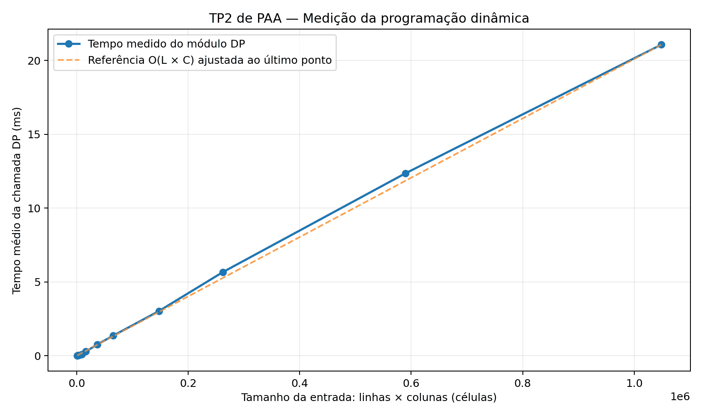

# Pessoa 4 — Testes, experimento e preparação da entrega

**Trabalho Prático 2 — Projeto e Análise de Algoritmos — UFV Campus Florestal**

**Data da medição:** 04/11/2026  
**Situação da integração:** parcial (somente o módulo `resolver_dp` da Pessoa 2 estava presente no ZIP fornecido).  
**Responsável:** Pessoa 4 — Bernardo Nery.

## 1. Objetivo

Elaborar e executar uma bateria de testes para verificar a solução do problema da caverna, a preservação dos pontos de vida, a legalidade do caminho e a maximização da vida ao chegar à saída `F`. Acrescentar um experimento de tempo de execução para observar a complexidade do módulo de programação dinâmica.

## 2. Estratégia de teste

Foram preparados 30 casos de entrada fixos, com saídas de referência, cobrindo os principais limites e situações do enunciado. As entradas seguem o formato: primeira linha com `L C vida_inicial`, seguida de `L` linhas com `C` células, incluindo exatamente um marcador `I` e um marcador `F`.

As categorias incluem cavernas quadradas e retangulares, uma única linha ou coluna, casos mínimos, início em diferentes bordas, saída inalcançável geometricamente, danos fatais, vida chegando a exatamente zero, poções, rotas concorrentes, múltiplos caminhos de mesma vida final e escolhas em que a rota aparentemente atraente não é sobrevivente.

Além disso, foram gerados 150 casos pseudoaleatórios reproduzíveis (`seed=20261104`). Para cada caso pequeno, foi utilizado um **oráculo independente por enumeração exaustiva de caminhos**, que calcula a maior vida final entre todas as rotas válidas que usam apenas movimentos para cima e esquerda.

O teste automatizado confirma, para cada execução: presença do início e do fim, índices válidos a partir de zero, movimentos admitidos, vida estritamente positiva em cada passo, vida final ótima e, para casos sem solução, arquivo contendo apenas a palavra `impossível`. Em caso de empate, qualquer caminho igualmente ótimo é aceito.

## 3. Resultados reais obtidos

O módulo `src/dp.c` foi compilado em conjunto com `tests/pessoa4/driver_dp.c` usando GCC e as opções `-std=c11 -O2 -Wall -Wextra -Wpedantic`.

| Conjunto | Casos | Aprovados | Falhas |
|---|---:|---:|---:|
| Entradas fixas | 30 | 30 | 0 |
| Entradas pseudoaleatórias | 150 | 150 | 0 |
| **Total** | **180** | **180** | **0** |

A execução do caso do enunciado (`02_exemplo_enunciado.txt`) produziu, com o driver isolado, um caminho ótimo:

```text
3 4
2 4
2 3
2 2
2 1
1 1
1 0
```

O caso `11_zero_intermediario.txt` retornou `impossível`, pois um passo intermediário reduziria a vida a zero; uma poção disponível depois desse ponto não permite sobreviver retroativamente.

**Nota sobre o enunciado:** a saída exemplificada no PDF original parece conter o par `4 4` para uma matriz com apenas quatro linhas (índices válidos `0` a `3`). Nosso verificador segue a regra textual de índices iniciados em zero e gera `3 4` para a posição inicial do exemplo.

**Aviso do compilador (código de outro integrante):** `include/dp.h` termina com `#endif;`, produzindo `warning: extra tokens at end of #endif directive`. Esse aviso não impediu a compilação e não foi alterado para preservar a autoria do módulo da Pessoa 2.

## 4. Experimento de complexidade

O módulo `resolver_dp` processa no máximo `L × C` células, com até duas transições por célula, e mantém estruturas proporcionais à quantidade de células. Portanto, o limite teórico esperado é **tempo `O(L × C)` e espaço adicional `O(L × C)`**, conforme explicado na seção da Pessoa 2.

O experimento foi feito separadamente sobre a chamada completa `resolver_dp`, incluindo a alocação e liberação de memória do módulo, sem a leitura do arquivo nem a gravação da saída. Foram usadas 11 cavernas quadradas de 32×32 até 1024×1024, com valores pseudoaleatórios determinísticos entre -3 e +3 e vida inicial suficientemente alta para não interromper o percurso. Para cada tamanho, mediu-se a mediana de três médias de tempo de CPU (`clock()`), usando GCC `-O2`.

| Células | Dimensões | Tempo médio (ms) |
|---:|---:|---:|
| 1.024 | 32×32 | 0,007540 |
| 2.304 | 48×48 | 0,015790 |
| 4.096 | 64×64 | 0,029540 |
| 9.216 | 96×96 | 0,076790 |
| 16.384 | 128×128 | 0,281960 |
| 36.864 | 192×192 | 0,757160 |
| 65.536 | 256×256 | 1,358520 |
| 147.456 | 384×384 | 3,022680 |
| 262.144 | 512×512 | 5,660714 |
| 589.824 | 768×768 | 12,352571 |
| 1.048.576 | 1024×1024 | 21,060571 |



A curva mostra crescimento aproximadamente proporcional à quantidade de células nos tamanhos maiores. Entre 256×256 e 1024×1024, a entrada foi multiplicada por 16 e o tempo medido por aproximadamente 15,5. A curva é consistente com a análise assintótica `O(L × C)`, sem constituir uma prova empírica rigorosa dessa complexidade.

O ambiente de medição, a velocidade da CPU, as condições de execução, a alocação dinâmica e efeitos de cache podem influenciar os tempos. Os valores são específicos da execução registrada e reproduzi-los em outra máquina não produzirá números idênticos.

## 5. Limitações e integração pendente

O ZIP recebido continha somente `src/dp.c`, `include/dp.h` e `docs/pessoa2.md`. Por esse motivo, o teste realizado valida diretamente o módulo de programação dinâmica, **não o executável final do grupo**. Quando a Pessoa 3 integrar o `main.c` e o `Makefile`, deve-se executar:

```bash
python tests/pessoa4/verificar.py --executavel ./programa
```

Isso permitirá conferir, separadamente, se o programa real recebe o caminho de entrada como argumento e grava `resultado.txt` no formato correto.

A medição feita nesta versão avalia o **tempo de CPU do módulo DP**, e não o tempo total fim a fim do programa com leitura e escrita. Para o extra 5, recomenda-se complementar a análise após a integração para que o resultado reflita literalmente o tempo total solicitado.

## 6. Como reproduzir

Na raiz do projeto, com GCC e Python 3 instalados:

```bash
python tests/pessoa4/gerar_casos.py
python tests/pessoa4/verificar.py
python benchmarks/pessoa4/executar.py
```

A terceira instrução também necessita da biblioteca Matplotlib em Python para gerar o gráfico.

## 7. Arquivos da contribuição

- `tests/pessoa4/casos/`: 30 cavernas de teste.
- `tests/pessoa4/esperados/`: caminhos de referência ou `impossível`.
- `tests/pessoa4/manifesto.json`: vida máxima e classificação de cada caso.
- `tests/pessoa4/driver_dp.c`: driver isolado do módulo.
- `tests/pessoa4/oraculo.py`, `gerar_casos.py`, `verificar.py`: verificador independente e ferramentas.
- `benchmarks/pessoa4/benchmark_dp.c`, `executar.py`, `plotar.py` e `tempos_modulo_dp.csv`: experimento e resultados.
- `docs/figuras/pessoa4_complexidade.png`: gráfico resultante.

## Referências técnicas

- Barbosa, Daniel Mendes. *Trabalho Prático 2*, Projeto e Análise de Algoritmos, UFV Campus Florestal, 2026.
- Documentação do próprio projeto: `docs/pessoa2.md`.
- ISO/IEC 9899:2011 — linguagem de programação C, biblioteca `<time.h>` (`clock`).
- Python Software Foundation. *Python 3 Documentation*. https://docs.python.org/3/
- Matplotlib Development Team. *Matplotlib Documentation*. https://matplotlib.org/stable/

> **Status:** esta seção pode ser incorporada ao PDF coletivo após revisão do grupo e inclusão dos nomes e matrículas. Não é o PDF final de entrega da equipe.
